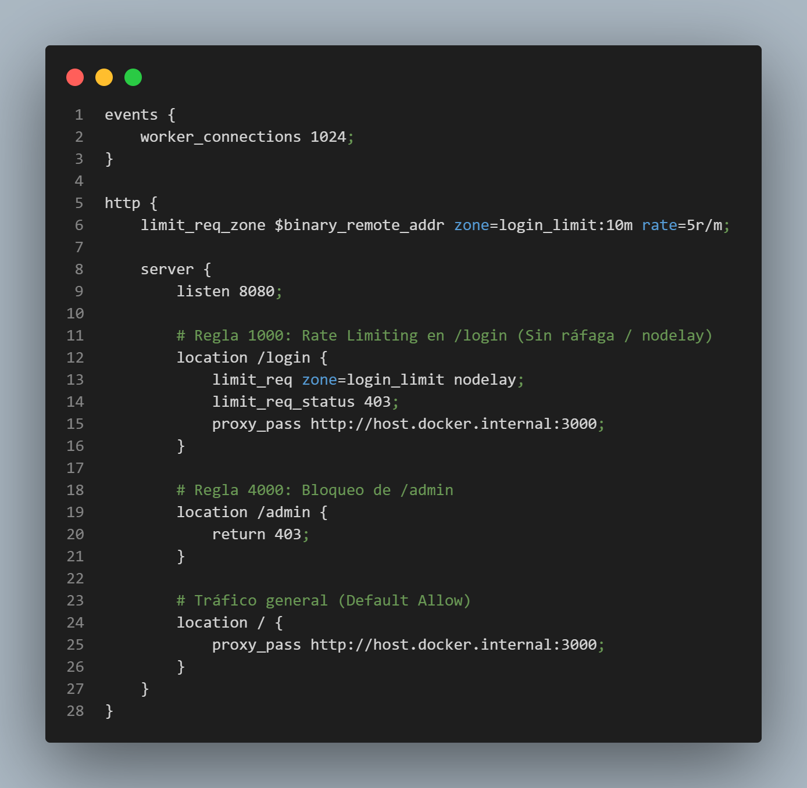
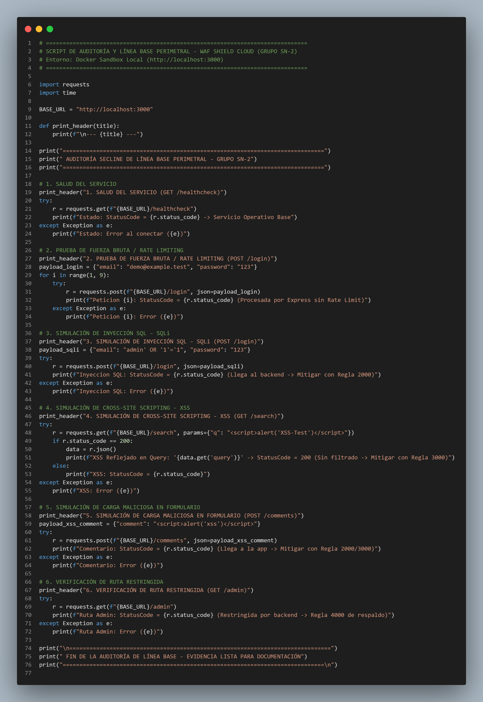

# 🛡️ Módulo de Seguridad Perimetral WAF — Fase 2

**Proyecto:** WAF Shield Cloud – Seguridad Perimetral para Aplicaciones en la Nube  
**Integrante:** Mauricio Alberto Grande Martínez  
**Rol:** Ingeniero de Seguridad Cloud Jr. (Grupo SN-2)  
**Entorno:** Docker Sandbox Local (Lenovo IdeaPad S145 se realizo prueba local)

---

## 📋 Resumen del Entorno y Objetivos

El objetivo de esta Fase 2 es evaluar empíricamente la efectividad de una capa de filtrado perimetral L7 previo al despliegue definitivo en Google Cloud Platform (GCP). 

Para garantizar la independencia operativa sin alterar la infraestructura ni interferir con el avance de los demás integrantes del grupo SN-2, se diseñó un **Docker Sandbox Aislado**:
* **Backend de Aplicación (`waf-sandbox`):** Contenedor `node:20-alpine` ejecutando la aplicación Express.js en el puerto interno `3000`.
* **Capa Perimetral Proxy (`nginx_waf`):** Contenedor `nginx:alpine` escuchando en el puerto `8080`, actuando como Reverse Proxy y capa de inspección L7.
* **Red de Contenedores:** Mapeo mediante `--add-host=host.docker.internal:host-gateway` para resolver las peticiones entre el proxy perimetral y el host local en Windows Docker Desktop.

---
## 📋 Descripción del contenido

Esta carpeta contiene la implementación técnica, los scripts de auditoría automatizada y las configuraciones de mitigación perimetral correspondientes a la **Fase 2**:

| Archivo | Lenguaje o formato | Descripción |
|---|---|---|
| `test_baseline_waf.py` | Python | Audita la superficie expuesta en el puerto `3000` (backend Express.js directo, sin filtro). |
| `nginx_waf.conf` | Nginx | Configura el reverse proxy en el puerto `8080`, con reglas de rate limiting y bloqueo de rutas perimetrales. |
| `test_waf_mitigated.py` | Python | Valida la capa mitigada en el puerto `8080` y registra bloqueos con el código `HTTP 403 Forbidden`. |
| `deploy_waf_policy.sh` | Bash / Google Cloud CLI | Transfiere la política `waf-shield-sn2-policy`, con las reglas 1000, 2000, 3000 y 4000, a Google Cloud Armor. |

---

## 💻 Código Fuente y Configuraciones

### 1. Configuración de Nginx WAF (`nginx_waf.conf`)


### 2. Script de Auditoría de Línea Base (`test_baseline_waf.py`)


### 3. Script de Auditoría Mitigada (`test_waf_mitigated.py`)


---

## 🧰 Tecnologías y herramientas

- **Python 3.x** — scripts de auditoría.
- **Requests** — solicitudes HTTP desde Python.
- **Nginx** — reverse proxy y configuración de reglas perimetrales.
- **Docker** — ejecución del backend y del proxy en contenedores.
- **Bash y Google Cloud CLI (`gcloud`)** — despliegue de la política en Google Cloud Armor.
- **Node.js 20 Alpine** — entorno del backend Express.js.
- **PowerShell** — comandos para ejecutar Docker en Windows.

## 🚀 Guía de ejecución y replicación local

### 1. Prerrequisitos

- Docker Desktop instalado y activo en Windows.
- Python 3.x instalado.
- La librería `requests` instalada:

```bash
pip install requests
```

### 2. Levantar el backend de aplicación (puerto 3000)

Ejecuta desde PowerShell, en el directorio del proyecto:

```powershell
docker run -d -p 3000:3000 --name waf-sandbox -v "${PWD}:/app" -w /app node:20-alpine sh -c "npm install && npm start"
```

### 3. Instanciar el reverse proxy WAF (puerto 8080)

```powershell
docker run -d --name nginx_waf -p 8080:8080 --add-host=host.docker.internal:host-gateway -v "${PWD}/nginx_waf.conf:/etc/nginx/nginx.conf:ro" nginx:alpine
```

### 4. Verificar los contenedores activos

```bash
docker ps
```

### 5. Ejecutar la auditoría de línea base (sin WAF)

```bash
python test_baseline_waf.py
```

### 6. Ejecutar la auditoría sobre la capa mitigada (con WAF)

```bash
python test_waf_mitigated.py
```

## 📁 Estructura del proyecto

```text
.
├── README.md
├── test_baseline_waf.py
├── nginx_waf.conf
├── test_waf_mitigated.py
└── deploy_waf_policy.sh
```
